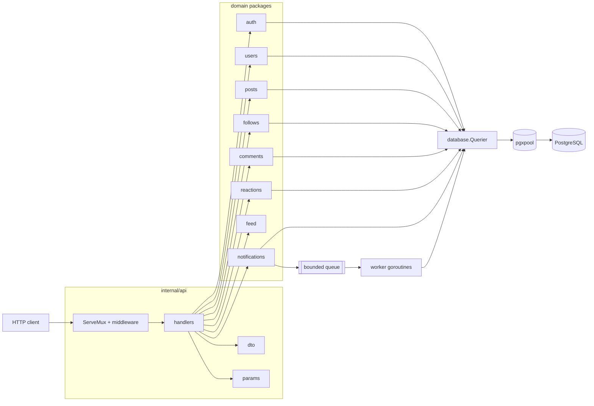
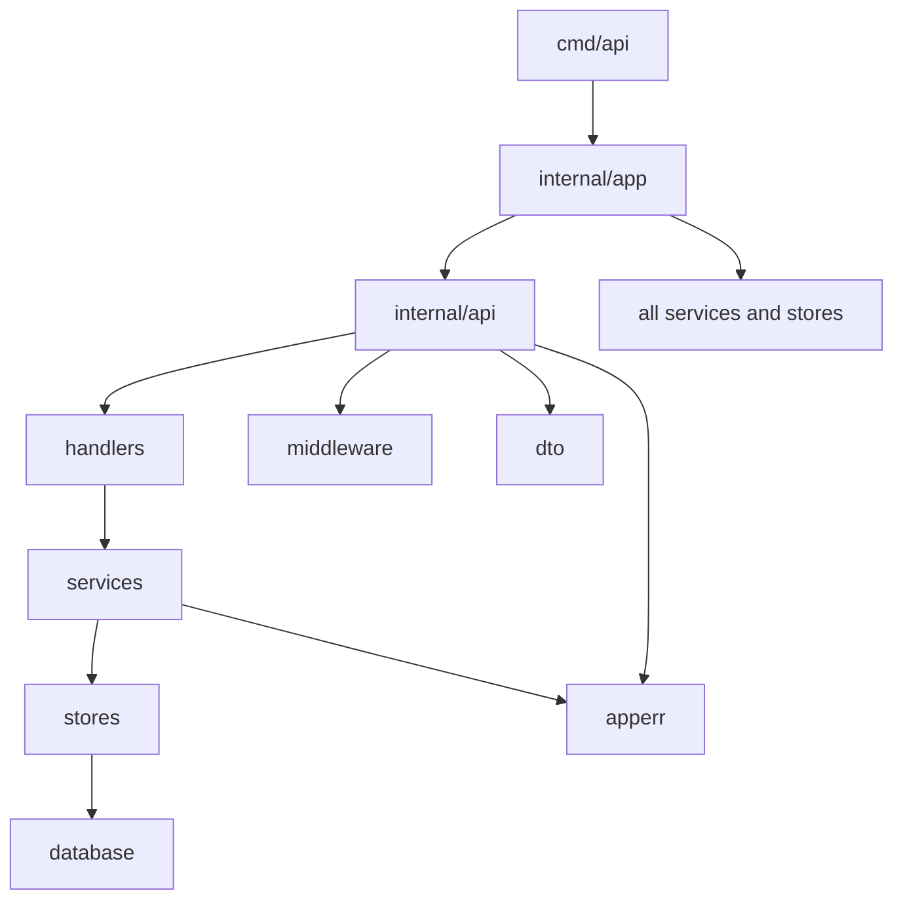
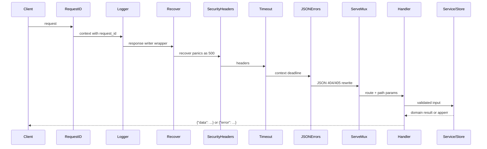
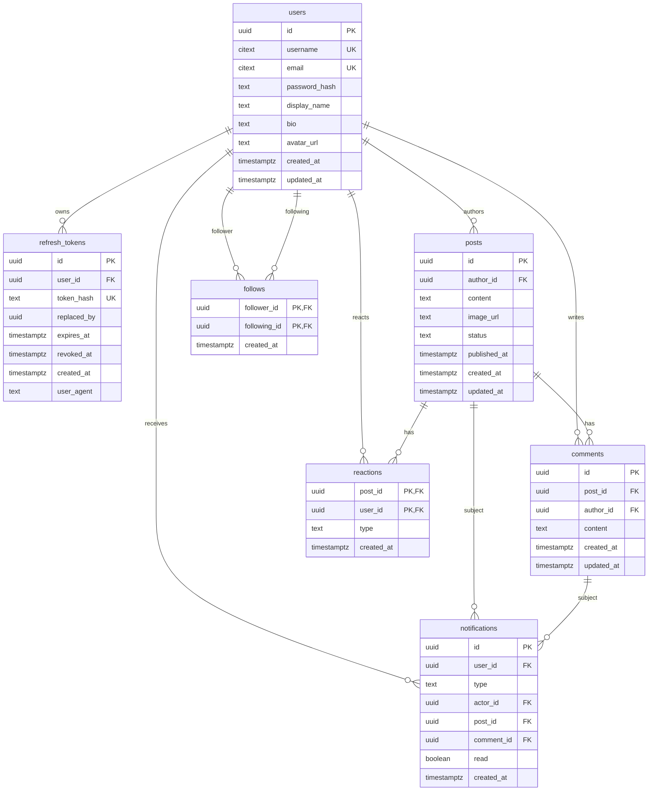
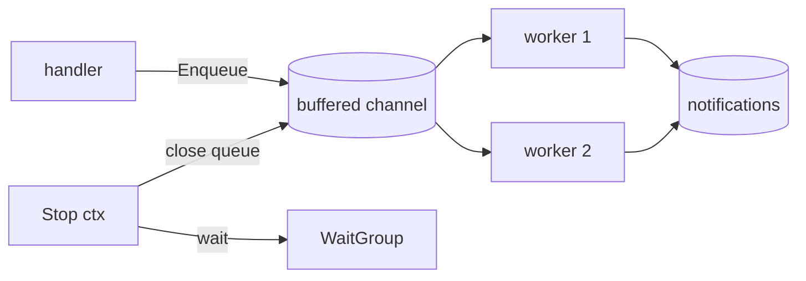

# Architecture

This document explains how GopherSocial is put together and why. It is meant to
be read before changing the code, and it is the map for the course modules in
`docs-learn/`.

## 1. The shape of the system



The dependency rule is simple: `api` may import domain packages, domain
packages may import `database`, `apperr`, `pagination`, and each other only when
the relationship is real (`feed` reads `posts`; `follows` emits notifications
through a small interface). Nothing imports `app` except `cmd/api`, and no
domain package imports `net/http`.



`internal/app` is the composition root. It is the only place that knows the
concrete types of every store and service. Constructors take interfaces, so
tests can replace a dependency without a framework.

## 2. Request lifecycle



Order matters. `RequestID` is outermost so every log line and error body has an
ID. `Recover` sits inside logging so panics still produce an access log entry.
`Timeout` wraps the mux, so handler and database work share one deadline.
`JSONErrors` is inside the timeout and immediately outside the mux: it only
needs to catch the plain-text 404/405 that `ServeMux` writes.

All routes are registered with Go 1.22 patterns (`GET /api/v1/posts/{postID}`),
so method mismatches return 405 with an `Allow` header, and path parameters are
read with `r.PathValue`.

## 3. Packages and responsibilities

| Package | Owns | Does not own |
| --- | --- | --- |
| `internal/api` | routing, middleware composition | business rules |
| `internal/api/handlers` | decode, validate, call service, map to DTO | SQL, token math |
| `internal/api/dto` | JSON shapes and mappers | domain behavior |
| `internal/api/params` | query/path parsing | defaults beyond HTTP |
| `internal/app` | construction, startup, shutdown | request handling |
| `internal/auth` | passwords, JWTs, refresh sessions | HTTP |
| `internal/users` | profiles, search, suggestions | authentication policy |
| `internal/posts` | post CRUD, visibility, feed queries | HTTP pagination parsing |
| `internal/follows` | social graph | notification delivery |
| `internal/comments` | comments and permissions | post existence checks beyond FK |
| `internal/reactions` | one reaction per user/post | feed ranking |
| `internal/feed` | feed/explore orchestration | SQL (delegates to posts) |
| `internal/notifications` | inbox, queue, workers | HTTP |
| `internal/pagination` | offset/keyset primitives | query params |
| `internal/database` | pool, querier, migrations | domain queries |
| `internal/apperr` | sentinel errors, validation errors | HTTP status codes |
| `internal/validation` | validator wrapper + field errors | request decoding |
| `internal/config` | env parsing and validation | secrets management |
| `internal/requestid` | request ID generation/context | logging format |

### Stores and the `Querier` abstraction

```go
type Querier interface {
    Exec(ctx context.Context, sql string, args ...any) (pgconn.CommandTag, error)
    Query(ctx context.Context, sql string, args ...any) (pgx.Rows, error)
    QueryRow(ctx context.Context, sql string, args ...any) pgx.Row
}
```

Both `*pgxpool.Pool` and `pgx.Tx` implement it. A store is constructed with a
`Querier`; a service that needs a transaction asks the database for a `WithTx`
helper and passes the transaction into the same store methods. This keeps SQL in
one place and makes transactions explicit at the call site.

Example: registration inserts a user and a refresh token. The service opens a
transaction, calls `users.Store.CreateTx` and `auth.Store.CreateRefreshTokenTx`,
then commits. A unique violation rolls the whole thing back, so no half-created
account exists.

### Domain models vs DTOs

Domain structs (`users.User`, `posts.Post`) have no JSON tags and may contain
private fields (`PasswordHash`, `Email`). DTOs in `internal/api/dto` decide what
leaves the process. That is why a store can add a column without changing the
API, and why `GET /users/{username}` cannot accidentally leak an email.

### Errors

`internal/apperr` defines sentinels:

```go
ErrBadRequest, ErrValidation, ErrUnauthorized, ErrForbidden,
ErrNotFound, ErrConflict, ErrRateLimited, ErrPayloadTooLarge
```

Stores wrap them with context: `apperr.Wrap(apperr.ErrNotFound, "post %s", id)`.
`response.Error` classifies once, emits a stable `code`, and hides unknown
errors behind `internal server error`. Validation errors carry field details.
Every error includes `request_id`.

## 4. Data model



Important constraints:

- `follows` has a composite primary key and a `CHECK (follower_id <> following_id)`.
- `reactions` has a composite primary key, so `INSERT ... ON CONFLICT` is the
  upsert and a user cannot react twice to one post.
- `posts.status` is constrained to `draft` / `published`; `published_at` is set
  when a post first becomes published.
- `refresh_tokens.token_hash` is unique; `replaced_by` links a rotated token to
  its successor. Reuse revokes every active session for the user.
- Search indexes are GIN over generated `tsvector` columns (see migration 8).

## 5. Authentication

```mermaid
sequenceDiagram
    participant C as Client
    participant A as Auth service
    participant DB as PostgreSQL

    C->>A: register(username, email, password)
    A->>A: Argon2id hash
    A->>DB: BEGIN; insert user; insert refresh token; COMMIT
    A-->>C: access JWT + opaque refresh token

    C->>A: refresh(raw token)
    A->>DB: SELECT ... FOR UPDATE by SHA-256(raw)
    alt token missing/expired/revoked
        A-->>C: 401
    else token already rotated
        A->>DB: revoke all user sessions
        A-->>C: 401 (reuse detected)
    else valid
        A->>DB: insert new, mark old replaced_by
        A-->>C: new access + refresh
    end
```

- **Passwords**: Argon2id, `m=65536, t=3, p=2`, PHC string format. Login
  compares against a dummy hash when the user does not exist, so response time
  does not reveal account existence.
- **Access tokens**: JWT HS256, 15 minutes, claims `sub` (user ID), `sid`
  (the refresh-token row ID), `iss`, `aud`, `iat`, `exp`, `jti`. The parser
  enforces the algorithm, issuer, and audience.
- **Refresh tokens**: 32 random bytes, prefixed `rt_`, base64url encoded. Only
  SHA-256 is stored. Rotation happens in a transaction with `SELECT ... FOR
  UPDATE`; presenting an already-rotated token revokes all of that user's
  active sessions.
- **Logout** revokes the presented token. **Password change** revokes every
  session for the user.

The access token is stateless, so a revoked session remains valid until the
access token expires (at most 15 minutes). That is the deliberate trade-off:
no database round-trip per request, bounded revocation window. If instant
revocation is required, add a `sid` denylist checked in middleware.

## 6. Pagination

Two strategies, chosen per endpoint:

| Strategy | Endpoints | Why |
| --- | --- | --- |
| Offset | posts list, comments, followers, notifications, search | Stable enough for small, bounded collections; supports jumping |
| Keyset (cursor) | feed, explore | New posts arrive constantly; offset would duplicate/skip items |

Cursor format is opaque base64url of `RFC3339Nano|uuid`, ordered by
`(created_at DESC, id DESC)`. The query uses a row comparison:

```sql
WHERE (p.created_at, p.id) < ($1, $2)
ORDER BY p.created_at DESC, p.id DESC
LIMIT $3
```

`limit+1` rows are fetched to compute `has_more` / `next_cursor` without a
`COUNT(*)`.

## 7. Feed and visibility

- A published post is visible to everyone.
- A draft is visible only to its author.
- `GET /posts/{id}` returns 404 (not 403) for a draft the viewer cannot see, so
  the API does not confirm existence.
- The feed contains posts from followed users plus the viewer's own posts.
- Explore contains published posts only.
- The feed query joins follows and filters in SQL; it does not load the
  following list into Go and issue N queries.

## 8. Background notifications

Follows, comments, and reactions enqueue a notification. The HTTP handler never
waits for delivery.



- Queue size and worker count come from config.
- `Enqueue` is non-blocking. If the queue is full, the event is dropped and a
  warning is logged. Notification delivery is best-effort by design; blocking a
  comment request on a slow notification insert is worse.
- `Stop(ctx)` closes the queue once, workers drain until the channel is empty,
  and the call returns when the wait group finishes or the context expires.
- `Start` and `Stop` are idempotent. `Enqueue` after `Stop` is a no-op, not a
  panic on a closed channel.

Self-notifications are skipped: following yourself is rejected, and a user
commenting/reacting on their own post does not notify themselves.

## 9. Configuration and startup

`internal/config` loads `.env` if present, then real environment variables
override it. It validates required values (JWT secret length, durations, ports,
limits) and fails fast with a readable error. No package reads `os.Getenv`
directly except config.

Startup order in `cmd/api`:

1. Load config.
2. Build logger.
3. Open pool and ping (with timeout).
4. Construct stores, services, handlers.
5. Start notification workers.
6. Start HTTP server.
7. Wait for `SIGINT`/`SIGTERM`.
8. Shut down HTTP with a deadline, then stop workers, then close the pool.

`/healthz` does not touch the database. `/readyz` pings it with a timeout, so a
load balancer can stop sending traffic before the process exits.

`/swagger/` serves the embedded Swagger UI and `/swagger/openapi.yaml` serves the
contract from `docs/openapi.yaml`. Both are public and bypass auth; the assets are
compiled into the binary, so there is no CDN or filesystem dependency.

## 10. Failure modes and trade-offs

| Decision | Benefit | Cost / mitigation |
| --- | --- | --- |
| No framework | explicit, small dependency surface | more wiring code; contained in `app` and `router` |
| Stateless JWT | no per-request session lookup | revocation window ≤ access TTL |
| Opaque refresh tokens | revocable, hashed at rest | one DB write per refresh |
| Best-effort notifications | request latency independent of inbox | events can be lost when queue is full; logged |
| Offset pagination for lists | simple, jumpable | can shift under concurrent inserts |
| Keyset for feed | stable under inserts | no random access |
| Real DB integration tests | catches SQL/concurrency bugs | requires PostgreSQL; tests skip if absent |
| `citext` usernames/emails | case-insensitive uniqueness | extension required (enabled in migration 1) |

## 11. Where to change what

- Add an endpoint: DTO → service method → handler → route → OpenAPI → tests.
- Add a column: migration up/down → domain model → store scan → DTO → docs.
- Add a notification type: migration constraint → enqueue call → DTO mapper →
  integration test.
- Change auth policy: `internal/auth` and `middleware/auth.go`; never in
  handlers.
- Change visibility: `internal/posts/store.go`; handlers must not filter.

## 12. Operational notes

- Logs are JSON when `APP_ENV=production`, text otherwise. Every request log
  includes method, path, status, duration, bytes, and request ID.
- Security headers include `X-Content-Type-Options`, `X-Frame-Options`, and
  `Referrer-Policy`. There is no CSP by default; the Swagger UI page needs its
  own scripts and styles, and the JSON API itself serves no HTML.
- The auth endpoints are rate limited per client IP with a fixed window. The
  limiter is in-process; for multiple instances use a shared store (Redis) or
  enforce at the edge.
- Request bodies are capped by `MAX_BODY_BYTES`; unknown JSON fields are
  rejected; trailing data is rejected.
- The server sets `ReadHeaderTimeout`, `ReadTimeout`, `WriteTimeout`, and
  `IdleTimeout`. Adjust for slow uploads if you add media.
